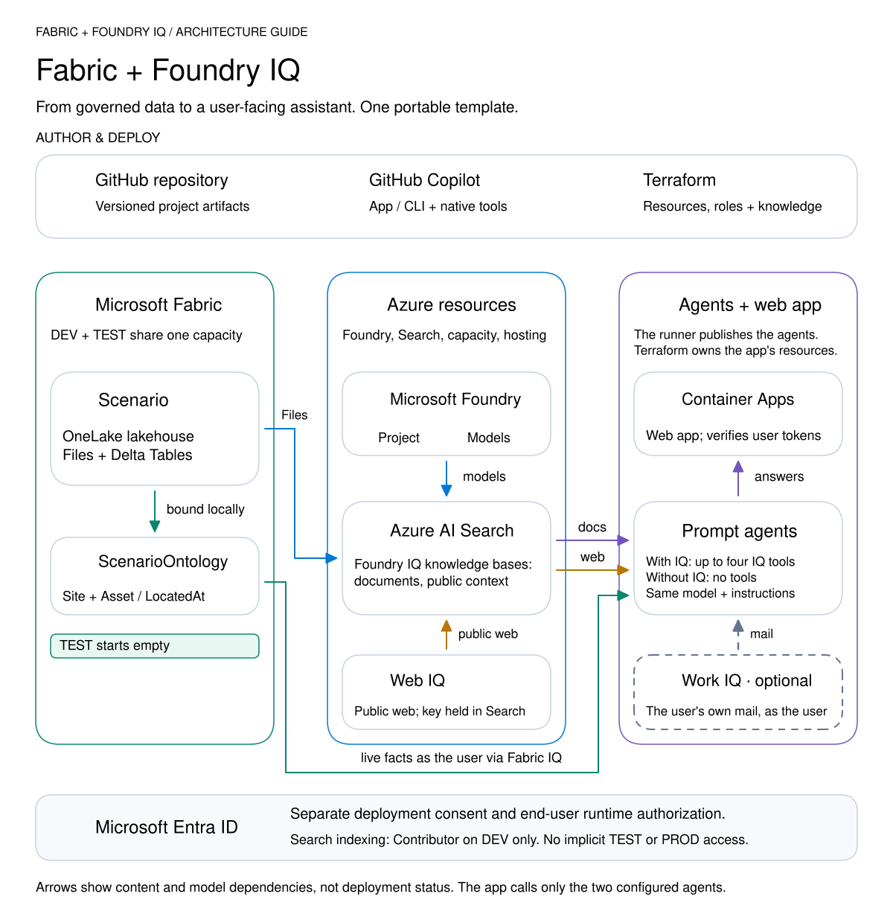

# Fabric + Foundry IQ template

A starter for independent **Fabric + Foundry IQ** projects: Terraform infrastructure, Git-versioned Fabric items, two Microsoft Foundry prompt agents (one with native IQ tools, one without), a Node.js web app on Azure Container Apps that asks them as the signed-in user, and guided Copilot deployment. Derived projects add their scenario workflow; they do not redesign this shell.

> [!IMPORTANT]
> This template is provided as is, without warranty or support, and you use it at your own risk.
> Deploying it creates billable Azure and Fabric resources, registers Entra applications and uses
> preview features. Read the [disclaimer](#disclaimer) before you deploy.

Fabric bootstrap uses native APIs by default: **no GitHub PAT required**.
Set `fabric_git_enabled = true` to opt into Fabric GitHub synchronization.

## What gets created

- **Azure:** resource group, Fabric capacity, container registry, Log Analytics and Application Insights (Entra ID only, no ingestion key), and a Container Apps environment with the web app.
- **Identity/access:** Entra deployment app/service principal, delegated scopes, authorized clients, the web app's single-page sign-in registration, the Work IQ registration only with Work IQ, managed identities and role assignments.
- **Fabric:** DEV/TEST workspaces and DEV-to-TEST deployment pipeline; GitHub credentials connection only with Git synchronization enabled.
- **DEV items:** `Scenario` lakehouse, `ScenarioOntology`, `SeedScenario`, `BindScenario` and `Bootstrap` deployment plan.
- **Seed data:** `dbo.demo_sites` (2 rows), `dbo.demo_assets` (3 rows) and `Files/documents/starter.txt`.
- **Foundry:** account, project, `agent`/`chat`/`embedding` model deployments, and Search, knowledge-base, public-context, Fabric IQ, Application Insights and, only with Work IQ, Work IQ connections.
- **Search:** service, one indexed OneLake source per knowledge folder with its generated ingestion assets, the agents' knowledge base, a check-only knowledge base with the live ontology source, and the Web IQ public-context source and knowledge base.
- **Web IQ:** global G3 account; portal AppID/key setup is manual.
- **Prompt agents:** `<project>-with-iq`, with the Fabric IQ, Foundry IQ, Web IQ and, opt-in, Work IQ mail tools, and `<project>-without-iq`, with none, published by the deployment runner.
- **Web app:** the React page and its Node server in one container, at a public HTTPS URL.
- **Tracing:** one Application Insights operation per question, from the web app's server through the agent run to each tool call; Foundry's message content goes only to a protected table the deployer can read.

## What is where

| Path | Contains |
| --- | --- |
| [`infra/`](infra/) | Terraform: Entra, Fabric, Foundry, Search, Web IQ, optional Work IQ, knowledge registration, the agents' connections and the app's hosting. |
| [`workspace/`](workspace/) | Fabric items: lakehouse, seed and bind notebooks, ontology and bootstrap plan. |
| [`agents/`](agents/README.md) | The two Foundry prompt agent variants: shared `agent.json` and `instructions.md`, and the with-IQ variant's `tools/`. |
| [`app/`](app/README.md) | The Container Apps web app: the React page, the Node server that verifies each user's token and asks the agents, and its image. |
| `scenario/` | Added by your project: data contracts, documents, workflow rules and evaluations ([contract](docs/scenario-authoring.md)). |
| [`cicd/`](cicd/README.md) | Native Fabric bootstrap and promotion. |
| [`docs/`](docs/getting-started.md) | Guides, starting with getting started. |
| [`.github/skills/`](.github/skills/) | Copilot skills that run each workflow. |

The devcontainer includes the [official Azure/Foundry IQ, Work IQ/M365 Agents
Toolkit and Fabric/Fabric IQ Copilot packages](docs/copilot-tooling.md).
Installation does not sign in, grant consent or enable optional runtime integrations.

**Before deployment:** complete the [manual preparation checklist](preparation.md)
for permissions, tenant settings, licenses, sign-ins and approvals.
[Web IQ runtime details](docs/runtime-integration.md#web-iq) cover the account,
public-search probe and the agents' public-context tool.

## Platform at a glance

[](docs/diagrams/platform-architecture.svg)

[Components and ownership](docs/architecture.md) | [All diagrams and editable sources](docs/diagrams/README.md)

The app reaches DEV through the [prompt agent route](docs/runtime-integration.md):
browser sign-in -> the Container App's server, which verifies the user's token ->
a Foundry prompt agent -> the Fabric IQ ontology and, opt-in, Work IQ mail as the
signed-in user, and the Foundry IQ documents and Web IQ public context as the project.

Explore the focused views: [agent runtime and identity](docs/runtime-integration.md#runtime-at-a-glance),
[indexed vs. live knowledge](docs/ontology-knowledge.md#two-retrieval-paths),
and [Fabric bootstrap and promotion](cicd/README.md).

For domain changes, follow the [scenario authoring contract](docs/scenario-authoring.md):
one discoverable layout, complete native artifact inventories and fixed
seed/bind/publish/readiness steps. Derived projects supply the scenario rather
than redesigning the platform.

## Get started

1. Select **Use this template** to create your own repository; it can be private. Don't fork this repository for a project: forks of a public repository are public, and they inherit the template setting, so the deployment runner refuses to deploy from them.
2. Open its **Codespace** for the prepared toolchain, or follow [developer setup](docs/development.md) for a local environment.
3. Tell Copilot **"Deploy the platform"**. When using Copilot App with Codespaces, name the Codespace to keep deployment in that checkout and state. It finishes with both agents published and the web app running at its Container Apps URL. To deploy without Copilot, run the same [deterministic runner](docs/development.md#deploy-deterministically) yourself: `python3 .github/skills/deploy-platform/scripts/deploy.py up`. It stops to ask for any missing choice, such as the subscription.

Review [prerequisites and manual steps](docs/getting-started.md) before deploying. You choose the target, complete every sign-in once at the start and approve the plans. The runner assumes you are an administrator, grants consent as you, and names a specific grant only if an API refuses. For **configuration only**, use **/initialize-project**.

Optional inputs, such as `work_iq_enabled`, `knowledge_folders`, `agent_model`
and `app`, are listed under [configuration keys](docs/getting-started.md#configuration-keys).

Use one explicit region by default. `location` is also the Foundry and app region,
so it must offer Foundry with the agent, chat and embedding models, Azure Container
Apps and Container Registry. Check Fabric CU quota first; the default
serverless Search tier is offered in fewer regions than dedicated tiers, which
also have new-service capacity limits. Approved `fabric_location` /
`search_location` overrides can retain working Foundry resources when a service
is unavailable in that region.

[](docs/diagrams/deployment-flow.svg)

[Deployment stages and approval gates](docs/deployment-flow.md) | [Single-prompt setup](docs/development.md#deploy-from-one-prompt)

## Delete the environment

From the original derived checkout, with its tfvars, backend and deployment receipts:

```sh
python3 .github/skills/deploy-platform/scripts/deploy.py down --non-interactive
```

Review the saved destroy plan, then approve the reported hash and native deletions:

```sh
python3 .github/skills/deploy-platform/scripts/deploy.py down --non-interactive \
  --allow-delete --approve "destroy=<sha256-prefix>" --approve purge-foundry
```

One reviewed Terraform destroy plan deletes every Terraform resource, including the
container app, its registry and sign-in registration, the Foundry project with both
agents, Application Insights and the Search ingestion assets; the runner then purges
the Foundry account. **Both Fabric workspaces and all their contents are deleted.**
`--yes` cannot approve teardown. Rerun `down` to resume.

Remaining cleanup:

- **Fabric tenant admin:** permanently delete the retained DEV/TEST workspaces; [retention still applies](https://learn.microsoft.com/en-us/fabric/admin/workspace-retention).
- **Microsoft Entra:** deleted app registrations stay under **Deleted applications** for 30 days; restore or permanently delete them there.
- **Web IQ portal:** revoke keys and remove the AppID/profile.
- **Preserved:** GitHub repository, local files/state, backend storage, tenant settings, licenses and external source data.

[Teardown details](docs/development.md#delete-the-environment)

## Scope and boundaries

- **Development baseline:** billable resources, authenticated public endpoints (including the web app), and preview ontology, deployment-plan, Foundry IQ, Fabric IQ tool and Web IQ features.
- **Separate next steps:** TEST starts empty; [native promotion](cicd/README.md) is a separate workflow. PROD, production ingestion, the scenario workflow, granting other users access, and hardening such as private networking belong to your derived project.
- **Runtime identity:** live ontology retrieval needs an end-user token; managed identity alone is insufficient. The with-IQ agent's Fabric IQ tool, and its optional Work IQ mail tool, run as the signed-in user; its Foundry IQ and Web IQ tools read their knowledge bases with the project's managed identity. See [runtime authentication](docs/ontology-knowledge.md#supply-the-end-users-identity-at-query-time) and the [access model](docs/runtime-integration.md#access-model).
- **Work IQ is opt-in:** `work_iq_enabled = false` by default. It needs a mailbox per user, a Copilot Credits spending policy that covers the Work IQ API, administrator consent and each user's one-time consent; see [Work IQ](docs/getting-started.md#work-iq). Without such a tenant it stays unverified.

## Contributing

This project welcomes contributions and suggestions through pull requests from forks; start with
[CONTRIBUTING.md](CONTRIBUTING.md). Most contributions require you to agree to a Contributor License
Agreement (CLA) declaring that you have the right to, and actually do, grant us the rights to use
your contribution. For details, visit [Contributor License Agreements](https://cla.opensource.microsoft.com).

This project has adopted the [Microsoft Open Source Code of Conduct](https://opensource.microsoft.com/codeofconduct/).
For more information see the [Code of Conduct FAQ](https://opensource.microsoft.com/codeofconduct/faq/) or
contact [opencode@microsoft.com](mailto:opencode@microsoft.com) with any additional questions or comments.
Report security issues as described in [SECURITY.md](SECURITY.md); for help, see [SUPPORT.md](SUPPORT.md).

Maintainers follow [AGENTS.md](AGENTS.md) and keep **Template repository** enabled in GitHub
**Settings > General**.

## Disclaimer

This template is a sample for development and evaluation. It is not supported under any Microsoft
standard support program or service, and it is provided AS IS without warranty of any kind.
Microsoft further disclaims all implied warranties including, without limitation, any implied
warranties of merchantability or of fitness for a particular purpose. The entire risk arising out
of the use or performance of the template and its documentation remains with you. In no event
shall Microsoft, its authors, or anyone else involved in the creation, production, or delivery of
the template be liable for any damages whatsoever (including, without limitation, damages for loss
of business profits, business interruption, loss of business information, or other pecuniary loss)
arising out of the use of or inability to use the template or its documentation, even if Microsoft
has been advised of the possibility of such damages.

You use the template at your own risk. In particular, you are responsible for:

- **Costs:** deployment creates billable Azure and Fabric resources, such as Fabric capacity,
  Azure AI Search, Foundry models, Container Apps, the container registry, Application Insights,
  Web IQ and, when enabled, Work IQ's Copilot Credits, that can incur charges until you
  [delete the environment](#delete-the-environment). Check pricing and quota first.
- **Preview features:** Fabric ontology, deployment plans, Foundry IQ, the Fabric IQ agent tool,
  serverless Search and Web IQ are previews. They are subject to the
  [Supplemental Terms of Use for Microsoft Azure Previews](https://azure.microsoft.com/support/legal/preview-supplemental-terms/)
  and their own terms, and may change or stop working without notice.
- **Your tenant and data:** deployment registers Entra applications, needs administrator consent,
  assigns roles and processes the data you add. Review every plan and permission before you
  approve it, and follow your organization's policies and applicable law.
- **Security and production use:** this is a development baseline with authenticated public
  endpoints, not a hardened production system. Complete your own security, privacy, compliance
  and Responsible AI reviews before any production use.
- **AI output and automation:** AI models and agents, including Copilot, can produce inaccurate or
  inappropriate output, and Copilot can run deployment commands for you. Check their output and
  every plan before you approve it.
- **Third-party components:** the tools, packages, plugins and services that the template
  installs or calls have their own licenses, terms and privacy statements, and some collect
  usage data.

## License

This project is licensed under the [MIT License](LICENSE). Third-party icons in the architecture
diagrams have their own terms; see [docs/diagrams/LICENSE](docs/diagrams/LICENSE).

## Trademarks

This project may contain trademarks or logos for projects, products, or services. Authorized use of Microsoft
trademarks or logos is subject to and must follow
[Microsoft's Trademark & Brand Guidelines](https://www.microsoft.com/legal/intellectualproperty/trademarks/usage/general).
Use of Microsoft trademarks or logos in modified versions of this project must not cause confusion or imply Microsoft sponsorship.
Any use of third-party trademarks or logos are subject to those third-party's policies.
