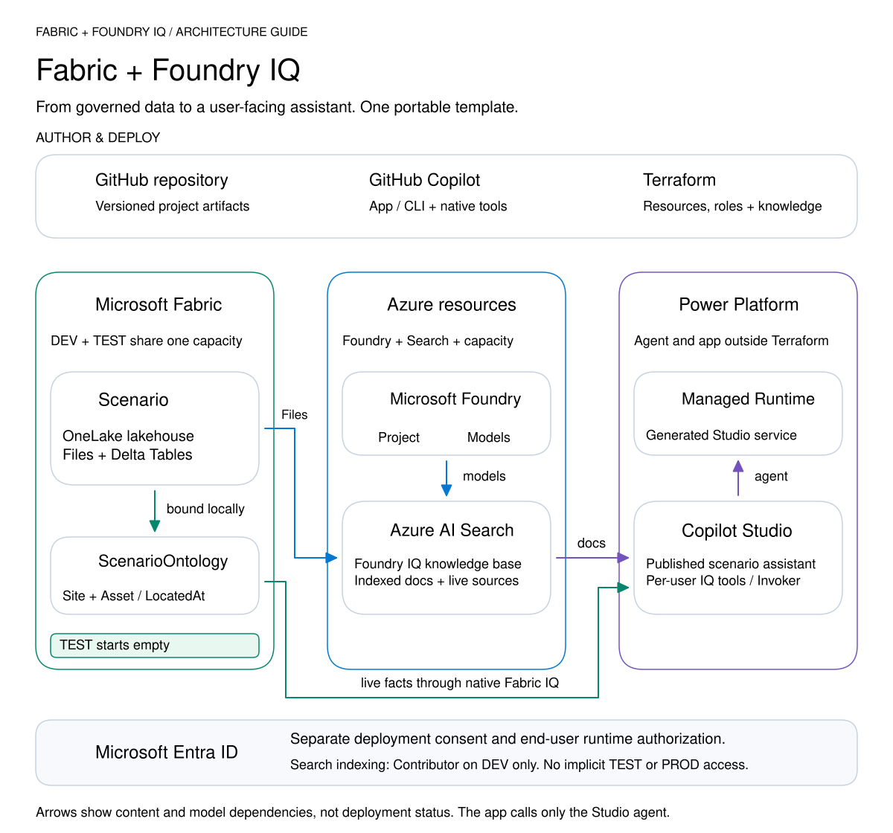

# Fabric + Foundry IQ template

A starter for independent **Fabric + Foundry IQ** projects: Terraform infrastructure, Git-versioned Fabric items, and guided Copilot deployment.

## Platform at a glance

[Components and ownership](docs/architecture.md) | [Ontology and retrieval](docs/ontology-knowledge.md)

## Get started

1. Select **Use this template** to create your own repository.
2. Open its **Codespace** for the prepared toolchain, or follow [developer setup](docs/development.md) for a local environment.
3. Tell Copilot **"Deploy the platform"**. When using Copilot App with Codespaces, name the Codespace to keep deployment in that checkout and state.

Review [prerequisites and manual steps](docs/getting-started.md) before deploying. You choose the target, sign in, arrange administrator consent and approve the plans. For **configuration only**, use **/initialize-project**.

[Deployment stages and approval gates](docs/deployment-flow.md) | [Single-prompt setup](docs/development.md#deploy-from-one-prompt)

## Scope and boundaries

- **Development baseline:** billable resources, authenticated public endpoints, and preview ontology, deployment-plan and Foundry IQ features.
- **Separate next steps:** TEST starts empty; [native promotion](cicd/README.md) is a separate workflow. PROD, production ingestion, consuming agents/apps and hardening belong to your derived project.
- **Runtime identity:** live ontology retrieval needs an end-user token; managed identity alone is insufficient. See [runtime authentication](docs/ontology-knowledge.md#supply-the-end-users-identity-at-query-time).

**Template maintainers:** follow [AGENTS.md](AGENTS.md) and enable **Template repository** in GitHub **Settings > General**.
