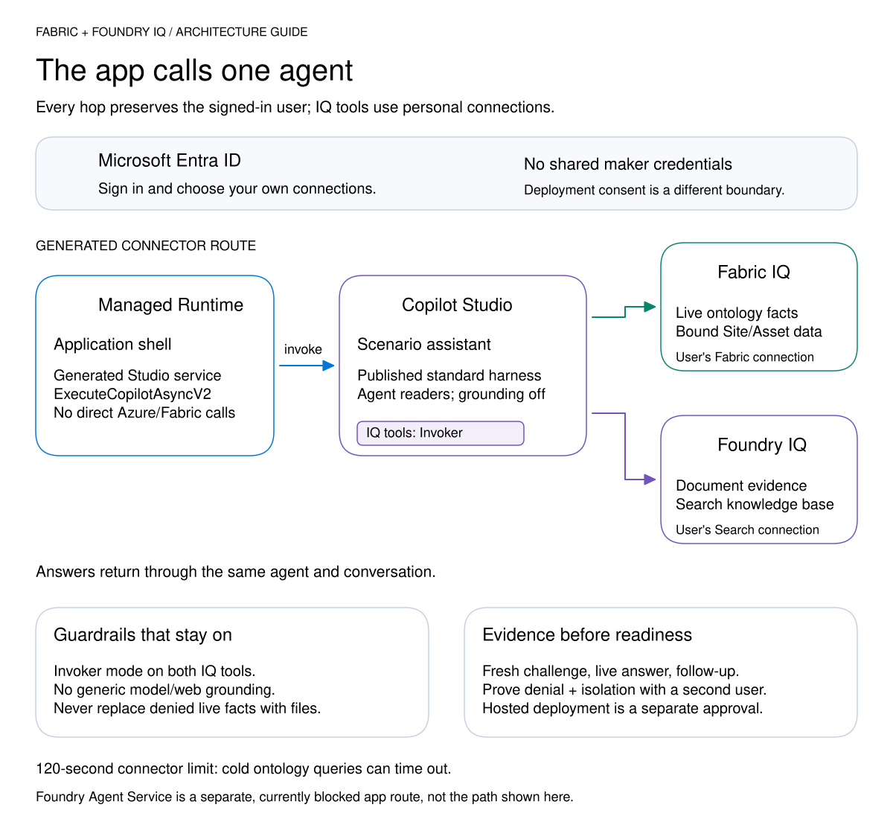

# Scenario assistant (Copilot Studio)

The app-facing agent: a **standard-harness** Copilot Studio agent with two native
MCP tools that run with each user's own credentials (`mode: Invoker`):

| File | Purpose |
| --- | --- |
| `agent.mcs.yml` | Instructions: source routing, inline source names, unavailable-source behavior. |
| `actions/FabricIQOntology.mcs.yml` | Live ontology facts through `shared_fabriciqmcpserver`. |
| `actions/FoundryIQKnowledge.mcs.yml` | Indexed documents through `shared_azureaisearchfoundryiq`. |
| `connectionreferences.mcs.yml` | The two connection references bound to each user's connections. |
| `topics/ConnectionProof.mcs.yml` | Deterministic readiness probe: returns `CPS_AGENT_PROOF|<message>`. |
| `topics/Fallback.mcs.yml` | Reports an unavailable source instead of a generic "rephrase" reply. |

`{{agent_schema}}`, `{{agent_display_name}}`, `{{knowledge_base_name}}` and
`{{search_api_version}}` are filled by
[`studio_agent.py render`](../../.github/skills/deploy-platform/scripts/studio_agent.py)
into a PAC workspace under `.artifacts/`. PAC supplies the remaining default
topics. Do not commit rendered workspaces or their `.mcs/` metadata.

Change the instructions and tool descriptions for a new scenario; keep both tools
in `Invoker` mode. Access, grounding settings and connection bindings are set by
`studio_agent.py configure`, because `pac copilot push` ignores
`settings.mcs.yml`. Follow the
[deployment skill](../../.github/skills/deploy-platform/SKILL.md) for the exact
order and approvals.
