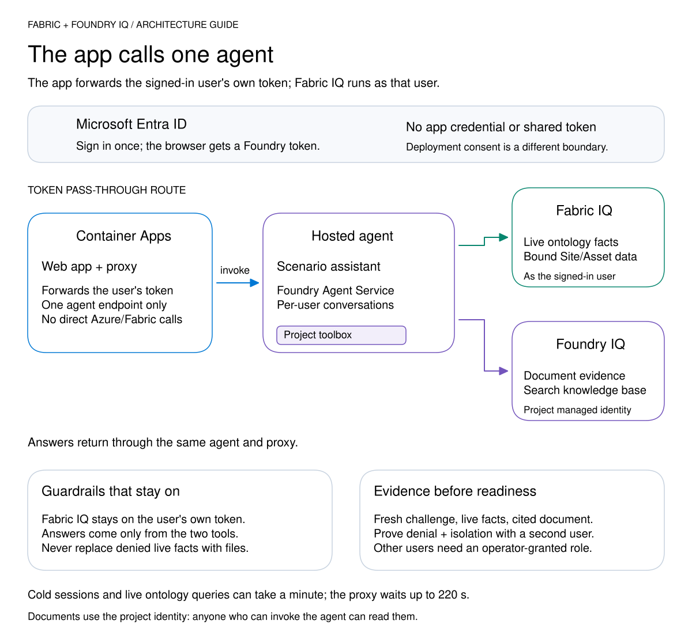

# Scenario assistant (Foundry hosted agent)

The app-facing agent: a Python
[Microsoft Agent Framework](https://learn.microsoft.com/agent-framework/overview/agent-framework-overview)
agent that runs as a Foundry hosted agent and answers only from its project
toolbox. Its Fabric IQ tool queries the live ontology as the signed-in user;
its knowledge-base tool retrieves documents with the project's managed identity.

| File | Purpose |
| --- | --- |
| `main.py` | The agent: `FoundryChatClient` on the project's `chat` deployment, `FoundryToolbox` for the project toolbox, and `ResponsesHostServer` serving the Responses protocol on port 8088. Its middleware answers `connection proof <uuid>` with `AGENT_PROOF|connection proof <uuid>` without calling the model or a tool. It skips the unused OpenAI Agents SDK trace instrumentation. |
| `instructions.md` | Source routing: current facts only from Fabric IQ, guidance only from the knowledge base, inline source names and unavailable-source behavior. |
| `hosted-agent.json` | Deployment definition: size (0.5 CPU, 1 GiB), the Responses protocol, environment variables, including `OTEL_INSTRUMENTATION_GENAI_CAPTURE_MESSAGE_CONTENT=false`, and the toolbox's two tools, `scenario_ontology` and `knowledge_base`. |
| `requirements.in`, `requirements.txt` | Direct dependencies and their hash-pinned closure. Regenerate `requirements.txt` with the command in `requirements.in`. |
| `Dockerfile`, `.dockerignore` | The `python:3.13-slim` image, installed with `--require-hashes` from an allow-listed build context. |

The [deployment runner](../../.github/skills/deploy-platform/scripts/deploy.py)
fills the `{{placeholders}}` in `hosted-agent.json` from Terraform outputs: the
`chat` model deployment, the `hosted_agent` toolbox endpoint, the `scenario`
Fabric IQ connection and the knowledge-base MCP endpoint and connection. It
never writes the rendered definition to the repository. Foundry injects
`FOUNDRY_PROJECT_ENDPOINT`; `FOUNDRY_*` and `AGENT_*` settings are reserved for
the platform.

The agent's spans and logs go to the project's Application Insights through
the connection string Foundry injects; see
[observability](../../docs/runtime-integration.md#observability). Keep message
content capture off outside a deliberate DEV debugging session.

Change the instructions and tool descriptions for a new scenario. Keep the
proof middleware, both tools' server labels and connections, and
`require_approval: never`, because the runner's checks and the web app depend
on them. The runner builds the image with `az acr build` from the published
commit, publishes the toolbox and agent versions, and proves them as the
deploying user. Follow the
[deployment skill](../../.github/skills/deploy-platform/SKILL.md) for the order
and approvals, and [runtime integration](../../docs/runtime-integration.md) for
identity, access and evidence.
