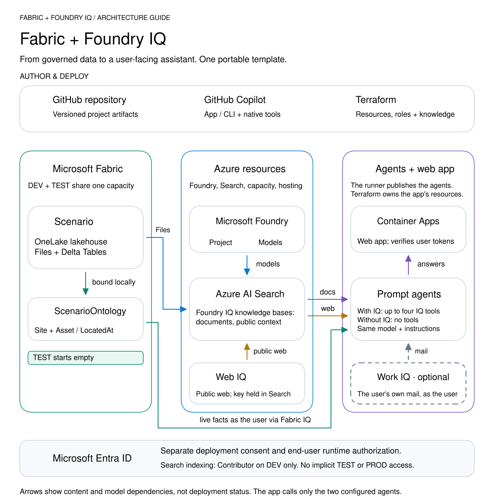

# Platform architecture

The intended **derived-project DEV baseline after bootstrap, knowledge wiring and the agents and app stage**, not a report of deployed resources. Copilot helps author and deploy all of it; the scenario workflow is the derived project's work.

Select the image for the full-size SVG. The [deployment flow](deployment-flow.md) shows how these components become ready.

## Focused views

| View | What it makes explicit |
| --- | --- |
| [Agent runtime and identity](runtime-integration.md#runtime-at-a-glance) | Browser sign-in, the app's token-verifying server, the two prompt agents, which identity each IQ tool uses, and where the traces go. |
| [Knowledge retrieval](ontology-knowledge.md#two-retrieval-paths) | Indexed document folders, the check-only live ontology source and the Web IQ public-context base, their model dependencies and the two authorization layers. |
| [Fabric bootstrap and promotion](../cicd/README.md) | Five portable Git items, seed/bind ordering and target-local data across DEV, TEST and separately provisioned PROD. |

## Components and ownership

| Component | What it contributes | Source of truth |
| --- | --- | --- |
| GitHub repository | Infrastructure configuration, five portable Fabric item definitions, the agent definitions, the app and native release guidance. | [`infra/`](../infra/), [`workspace/`](../workspace/), [`agents/`](../agents/README.md), [`app/`](../app/README.md), [`cicd/`](../cicd/README.md) |
| GitHub Copilot App / CLI | Guided configuration and deployment through repository skills, with a Codespaces/devcontainer toolchain for Terraform, Azure CLI, the web app and the IQ Copilot packages. | [Developer setup](development.md) |
| Microsoft Entra | Deployment-user app registration, delegated scopes and authorized clients; the app's single-page sign-in registration for the delegated Foundry scope; with Work IQ, the public-client registration of Foundry's `work-iq` connection. The deploying administrator grants their consent (the runner does it as them; another administrator only if Entra refuses); each user's sign-in and tool consent are separate. | [`infra/identity.tf`](../infra/identity.tf), [`infra/app.tf`](../infra/app.tf), [`infra/work_iq.tf`](../infra/work_iq.tf), [identity bootstrap](getting-started.md#3-bootstrap-the-fabric-user-auth-application) |
| Microsoft Fabric | One capacity shared by DEV and TEST, workspace roles and native deployment pipeline. Native bootstrap needs no PAT; Git sync and its credentials connection are opt-in. | [`infra/fabric.tf`](../infra/fabric.tf) |
| Fabric DEV items | `Scenario` lakehouse, `SeedScenario`, `ScenarioOntology`, `BindScenario` and the `Bootstrap` deployment plan. Notebooks insert missing demo content and bind to the current workspace's lakehouse through its SQL analytics endpoint. | [`workspace/`](../workspace/), [bootstrap and promotion](../cicd/README.md) |
| Azure AI Search / Foundry IQ | Search service (serverless preview by default); one indexed OneLake source per knowledge folder; the agents' knowledge base; a check-only knowledge base holding the live ontology sources; and the Web IQ public-context source and knowledge base. All are Search data-plane resources. | [`infra/knowledge.tf`](../infra/knowledge.tf), [`infra/web_iq.tf`](../infra/web_iq.tf) |
| Microsoft Foundry | Account, project, the `agent`, `chat` and `embedding` model deployments, and the project connections: Search, the knowledge-base and public-context MCP connections using the project managed identity, Fabric IQ `UserEntraToken` connections, Application Insights and, with Work IQ, the `work-iq` OAuth connection. | [`infra/foundry.tf`](../infra/foundry.tf), [`infra/monitoring.tf`](../infra/monitoring.tf) |
| Web IQ | Global G3 account, portal AppID linking and public-search verification; the agents reach it only through the public-context knowledge base, whose source holds the key. | [`infra/web_iq.tf`](../infra/web_iq.tf), [runtime details](runtime-integration.md#web-iq) |
| Foundry prompt agents | `<project>-with-iq`, with the Fabric IQ, Foundry IQ, Web IQ and optional Work IQ mail tools, and `<project>-without-iq`, with none: one model and one set of instructions. Published by the runner from the reviewed definitions, not by Terraform. | [`agents/`](../agents/README.md), [step 7](getting-started.md#7-create-the-agents-and-app) |
| Azure Container Apps web app | The React page and its Node server in one container. The server verifies each user's Foundry token and forwards it to the configured project's Responses API. Terraform owns the registry, environment, container app, identity and sign-in registration; the runner builds the image. | [`app/`](../app/README.md), [`infra/app.tf`](../infra/app.tf), [runtime integration](runtime-integration.md) |
| Monitoring | Log Analytics and one Application Insights resource that accepts Entra ID only, for the app's value-free spans and Foundry's traces of the agent runs; Foundry's message content goes only to the protected `AppGenAIContent` table. | [`infra/monitoring.tf`](../infra/monitoring.tf), [traces and telemetry](runtime-integration.md#traces-and-telemetry) |

Terraform owns infrastructure, registrations, connections and role assignments, not the Git-owned lakehouse or ontology definitions or the agent versions. The Azure resource group contains the capacity, Foundry, Search, Web IQ, container registry, monitoring and Container Apps resources; Fabric workspaces/items and Entra objects have their own service boundaries.

One explicitly selected region is the default. Approved `fabric_location` and
`search_location` overrides allow a service-specific region without moving
existing Foundry resources; `service_locations` reports the effective choices.
Overrides require a cross-region data-handling and cost review, not an automatic
capacity workaround.

## Knowledge paths

| Path | Data and behavior | Identity |
| --- | --- | --- |
| **Indexed documents** | Each `knowledge_folders` entry, such as `documents` for the DEV lakehouse's `Files/documents` with `starter.txt`, feeds its own `indexedOneLake` source, checked every five minutes with the embedding model. The agents' knowledge base holds only the attached folders and answers at minimal effort with extractive passages. The lakehouse's Tables area isn't indexed. | Search's managed identity has **Contributor on DEV only** and access to the Foundry models. The agents read the knowledge base as the project's managed identity. |
| **Live ontology** | The with-IQ agent queries the bound Site/Asset ontology through native **Fabric IQ**. A registered `fabricOntology` source also queries it at request time, but only in the check-only knowledge base that the runner's `verify` uses. Neither copies tables into an index. | Fabric IQ runs as the signed-in user (`UserEntraToken`). The Search source needs an **end-user Search-audience token** in `x-ms-query-source-authorization`. |
| **Public context** | Web IQ is the only source of the separate public-context knowledge base, so no document question triggers a web search. | The agents read it as the project's managed identity; Search calls Web IQ with the key it holds. Queries carry public terms only. |

The public-context and check-only knowledge bases use the `chat` model for query planning and answer synthesis; the agents run on their own `agent` deployment. The project's managed identity authenticates to Search; it does **not** replace the end-user token that live ontology queries need. With Work IQ, the agent also reads the user's own mail through Work IQ's MCP server, as that user.

Knowledge sources, knowledge bases and their MCP connections remain disabled while `knowledge_lakehouse_id` is null. After DEV bootstrap, Terraform uses physical DEV item GUIDs to look up the Git-owned items. An empty `knowledge_ontologies` map selects document-only retrieval: without a Fabric IQ connection, the agent phase can't publish the with-IQ agent. See [ontology knowledge and runtime authentication](ontology-knowledge.md).

## Reply format

The agents share one set of instructions, so both answer in the same Markdown
format, in three parts:

1. **The answer**: the direct answer first, in bold, with a source marker right
   after each fact.
2. **Sources**: a line "Sources", then one line per marker.
3. **Steps**: a line "Steps", then a numbered list of the tools called, what each
   was asked and what it found, or that no tool was called.

| Marker | Source line | IQ |
| --- | --- | --- |
| `[D1]` | `[D1] ScenarioOntology · <entity> · <key>` | Fabric IQ: ontology data |
| `[F1]`, `[F1 §2]` | `[F1] <document title> · <section>` | Foundry IQ: an approved document, optionally its section |
| `[Web1]` | `[Web1] <page title> · <site> · <URL>` | Web IQ: public context |
| `[W1]` | `[W1] Outlook · <sender> · <date> · <subject> · <link>` | Work IQ: a mail message |

The agents never use Foundry's own `【1:2†source】` citations, and never write a
marker for a tool they lack or didn't call. There is no JSON contract to validate.
The app's parser, [`app/src/live/reply.ts`](../app/src/live/reply.ts), accepts the
section headings plain, bold, as Markdown headings or with a trailing colon, and
treats a reply without them as all answer. Its renderer escapes everything, allows
a small Markdown subset and turns markers into IQ-colored chips. Change the
[shared instructions](../agents/scenario-with-iq/instructions.md), the parser and
its tests, and the mock answers in
[`app/src/mock/client.ts`](../app/src/mock/client.ts) together.

## Reading the boundaries

In this overview, arrows point toward the consuming component: Files feed Search, models support retrieval, and document evidence, public context and live facts reach the prompt agents. The live-facts path bypasses Search through the native Fabric IQ tool; the separate [knowledge retrieval view](ontology-knowledge.md#two-retrieval-paths) explains Search's check-only live ontology source. The [runtime view](runtime-integration.md#runtime-at-a-glance) shows invocation direction instead.

The agents are published after DEV readiness, outside Terraform state, and the app's container is created once its image exists. The with-IQ agent reads live ontology facts and, with Work IQ, mail with the signed-in user's identity, and documents and public context with the project's managed identity. The diagram's Fabric group is a service boundary, not an Azure resource group: the capacity is an Azure resource, while Fabric workspaces and items live in Fabric.

TEST is provisioned but stays empty until a reviewed native promotion. Imports, Git sync and deployment pipelines carry definitions, not OneLake data; every promoted target needs its own binding. The agents and app serve DEV only. PROD, production ingestion, the scenario workflow, other users' access and production hardening belong to the derived project. The baseline is billable, uses authenticated public endpoints and includes preview features; see [getting started](getting-started.md#keep-in-mind).

## Reference architectures

The template builds on Microsoft's [Fabric capacity quickstart](https://github.com/microsoft/fabric-terraform-quickstart/tree/main/quickstarts/102-fabric-capacity), [Foundry Terraform guidance](https://learn.microsoft.com/azure/foundry/how-to/create-resource-terraform?tabs=azapi), and [OneLake knowledge-source documentation](https://learn.microsoft.com/azure/search/agentic-knowledge-source-how-to-onelake).

[Editable Excalidraw source](diagrams/platform-architecture.excalidraw) | [Authoring and icon sources](diagram-authoring.md)
