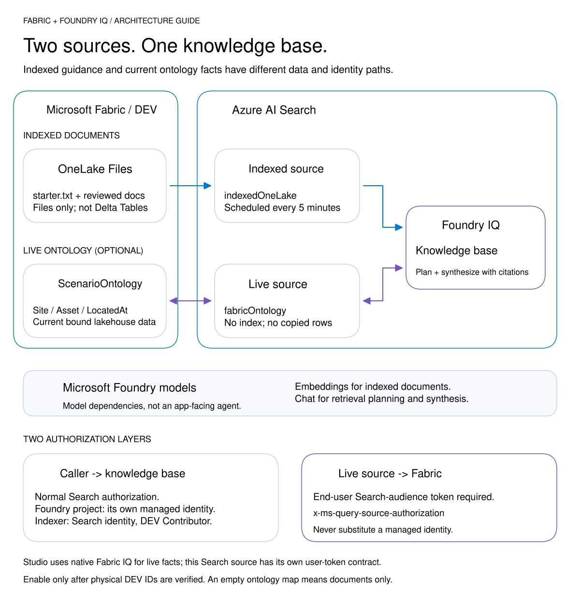
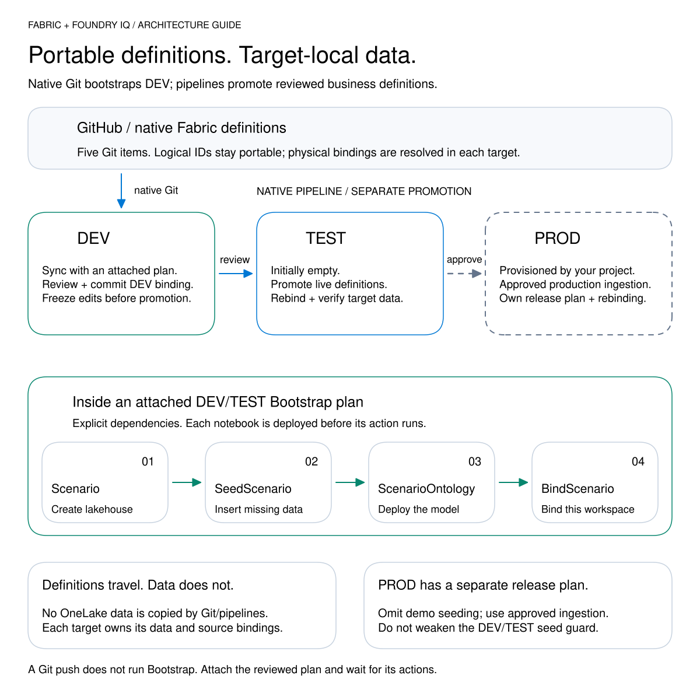

# Architecture diagrams

Five focused views keep the platform overview readable without hiding runtime,
identity or promotion boundaries. Select an SVG for the full-size diagram; each
guide embeds the image beside its text equivalent.

The self-contained SVGs stay sharp at any zoom. Editable Excalidraw sources live
beside each image.

## Previews

### Platform architecture

### Deployment flow

### Agent runtime

### Knowledge retrieval

### Fabric lifecycle

[Authoring guide](../diagram-authoring.md) | [Icon licenses](LICENSE)
