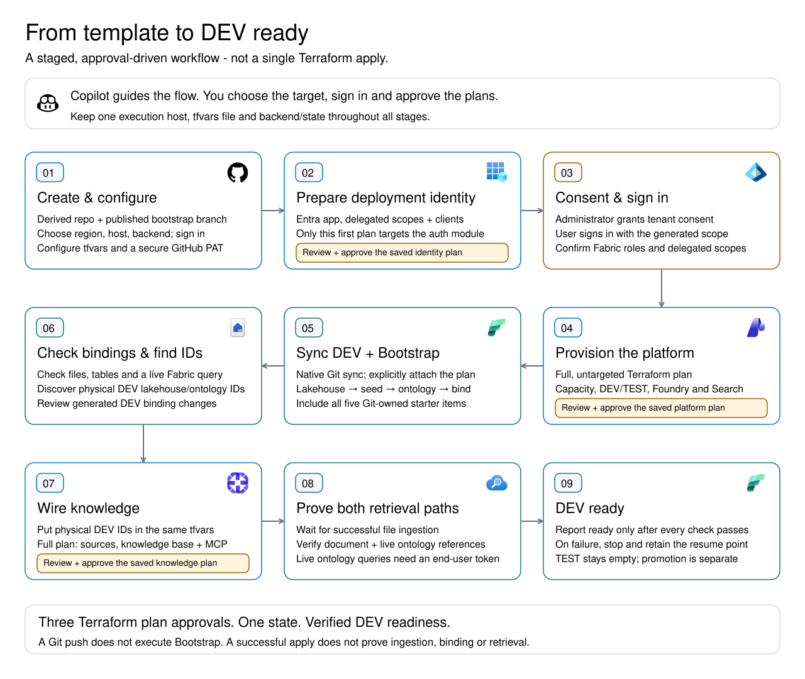

# Getting started

Use this template for a **new project**, not an existing deployment. Each derived repository gets its own resources and Terraform state.

For a visual overview, see the [platform architecture](architecture.md) and [deployment flow](deployment-flow.md). The prepared toolchain includes the [official Microsoft IQ Copilot packages](copilot-tooling.md); their MCP authentication and runtime connections remain separate from image installation.

**Guided App/CLI path:** open the derived repository's Codespace and tell Copilot **"Deploy the platform"**. The [deployment skill](../.github/skills/deploy-platform/SKILL.md) carries out all stages below, asks for missing choices/sign-in and plan approvals, verifies document and live ontology retrieval, then creates the scenario agent and app. For App, direct it to that same Codespace through GitHub CLI SSH. See [single-prompt setup, credentials and state retention](development.md#deploy-from-one-prompt).

**Deterministic path:** the skill drives the same [runner](development.md#deploy-deterministically) that you can run yourself, with the same gates and no AI agent: `python3 .github/skills/deploy-platform/scripts/deploy.py up`. The steps below remain the canonical manual flow and the runner's contract.

[](deployment-flow.md)

Read each row left to right, then continue down. The diagram's ten stages expand
the seven manual sections below; [stage details](deployment-flow.md) distinguish
DEV readiness from the agent/app and later promotion.

## Prerequisites

- **Tools:** open the included [Codespaces/devcontainer](development.md), or install Git, Bash, [Terraform 1.11+ (below 2.0)](https://developer.hashicorp.com/terraform/install), and [Azure CLI](https://learn.microsoft.com/cli/azure/install-azure-cli) locally. The optional initializer also uses Python 3. The container includes Copilot CLI, Node.js 24, the .NET 10 SDK for the repository-pinned Power Platform CLI (`dotnet pac`), and the Copilot Managed Runtime plugin, `ms` CLI, Git Credential Manager and native build dependencies for the [agent and app stage](#7-create-the-agent-and-app). No local Spark, Fabric CLI or fabric-cicd installation is required; notebooks run in Fabric.
- **Azure access:** subscription Owner, or Contributor plus Role Based Access Control Administrator/User Access Administrator. Allow registration of `Microsoft.Fabric`, `Microsoft.CognitiveServices`, and `Microsoft.Search`; Terraform handles registration and resource-scoped role assignments. The default serverless (preview) Search tier also needs the subscription's auto-approved `Microsoft.Search/Serverless` feature: run `az feature register --namespace Microsoft.Search --name Serverless`, then `az provider register --namespace Microsoft.Search`, or pass `--register-search-serverless` to the runner.
- **Entra access:** an existing identity allowed to create/configure app registrations, owners, service principals and pre-authorized clients, and an administrator authorized to grant tenant consent. Azure subscription ownership does **not** grant these directory permissions. The [AzureAD provider](https://registry.terraform.io/providers/hashicorp/azuread/latest/docs) uses the existing sign-in, not the app it is creating. The tenant must already have the Microsoft **Power BI Service** enterprise application so its published scopes can be read; the template does not take ownership of that shared Microsoft application.
- **Fabric access:** an authorized user allowed to create workspaces, connections and deployment pipelines, listed in `fabric_capacity_admins`. Step 3 prepares the provider's [CLI user authentication setup](https://registry.terraform.io/providers/microsoft/fabric/1.14.0/docs/guides/auth_app_reg_user); an administrator then grants consent. The identity connecting Git needs workspace Admin. Bootstrap notebooks need execution/write access, including `Item.ReadWrite.All` for ontology binding and SQL metadata refresh. An administrator must enable Git/GitHub synchronization, applicable cross-geography export, **Users can create ontology (preview) items**, and **Users can create deployment plan (preview) items** ([Git prerequisites](https://learn.microsoft.com/fabric/cicd/git-integration/git-get-started#prerequisites), [ontology settings](https://learn.microsoft.com/fabric/iq/ontology/overview-tenant-settings), [plan prerequisites](https://learn.microsoft.com/fabric/cicd/deployment-plan/how-to-create-deployment-plan)). This template does not change tenant settings.
- **OneLake access:** Search and Fabric must share a tenant. Enable external-app OneLake access and service-principal Fabric APIs. The [OneLake indexer](https://learn.microsoft.com/azure/search/search-how-to-index-onelake-files#grant-permissions) requires **Contributor on DEV** for the Search managed identity; Terraform grants it, not access to TEST/PROD.
- **Region and quota:** choose a region supporting [Fabric](https://learn.microsoft.com/fabric/admin/region-availability), [Search agentic retrieval](https://learn.microsoft.com/azure/search/search-region-support), the [serverless Search tier](https://learn.microsoft.com/azure/search/search-sku-tier#serverless-pricing-model-preview) (or set `search_sku` to a dedicated tier such as `basic`), and the model versions/SKUs in [`variables.tf`](../infra/variables.tf). Check actual available [Fabric CUs](https://learn.microsoft.com/fabric/enterprise/fabric-quotas), model quota, and, for dedicated Search tiers, Search's current new-service capacity restrictions; regional support alone is insufficient. Confirm quota or override `chat_model`/`embedding_model`.
- **GitHub token:** a fine-grained PAT for the **new repository**, with **Contents: Read and write**, approved/SSO-authorized by your organization where required.
- **Agent and app:** a Power Platform environment with Dataverse where you can create Copilot Studio agents and Managed Runtime apps, a Copilot Studio license or trial, and [Managed Runtime licensing](development.md#build-and-deploy-copilot-managed-runtime-apps). Connector policies must allow Copilot Studio, Fabric IQ and Foundry IQ. Binding the app to this repository requires GitHub Enterprise Cloud and the Microsoft Managed Apps GitHub App.

## 1. Create your repository

On GitHub, select **Use this template > Create a new repository**, then open **that repository** in Codespaces or clone it locally. Keep the five item folders under `workspace/`, including their `.platform` logical IDs: these are portable identities, not someone else's deployment bindings. The notebooks resolve physical bindings in each target workspace. Select your new repository's published bootstrap branch and `/workspace` directory; do not select an unpublished Copilot worktree branch. Push any customization to the selected branch before synchronizing Fabric.

## 2. Configure

**With Copilot App/CLI:** from the repository root, ask it to **use /initialize-project**. The skill confirms your project, region and Fabric admin, resolves the new GitHub repository and published branch, then creates only the ignored `infra/terraform.tfvars`. It does not sign in or deploy, and refuses existing local configuration/state.

**Manually:** copy `infra/terraform.tfvars.example` to `infra/terraform.tfvars` without overwriting an existing file. Edit its **six placeholders**: `project_name`, `location`, `fabric_capacity_admins`, `github_owner`, `github_repository_name`, and `github_branch_name`. Use your new repository's details and a distinct, short project name. The capacity admin is your Fabric identity's user UPN or service-principal **object ID**. The initializer also works [directly without Copilot](development.md#what-gets-templated).

For either path, leave `knowledge_lakehouse_id = null` and `knowledge_ontologies = {}` through identity and platform setup. Start with a normal Azure CLI user sign-in in the chosen tenant. This lets Terraform prepare Entra configuration; the Fabric-scoped sign-in comes **after** registration and consent in step 3. Work from `infra/` for the remaining Terraform commands:

`location` is the common region and the Foundry/resource-group region. Keep that
default when available. If quota or regional service capacity blocks a service,
explicitly choose `fabric_location` and/or `search_location` in the same ignored
tfvars file. They default to `location`. Review cross-region data handling,
latency and traffic costs; the services still need the same Entra tenant. Never
change an existing region as an automatic retry: review the full replacement
plan and preserve the original state.

```sh
az login --use-device-code --tenant "<tenant-id>"
az account set --subscription "<subscription-name-or-id>"
cd infra
```

Subscription/authentication come from the active Azure CLI account or standard `ARM_*`/`FABRIC_*` provider variables; `ARM_SUBSCRIPTION_ID` takes precedence over the CLI subscription. No subscription ID goes in tfvars. For azd environments, export `ARM_SUBSCRIPTION_ID="$(azd env get-value AZURE_SUBSCRIPTION_ID)"`; azd login alone does not authenticate AzureRM. Service-principal automation also requires the Fabric tenant's service-principal API setting.

For Codespaces, prefer the repository-scoped `FABRIC_GITHUB_TOKEN` secret described in [developer setup](development.md#deploy-from-one-prompt). In each Terraform plan/apply shell, map it without printing it:

```sh
set +x
export TF_VAR_github_token="${TF_VAR_github_token:-${FABRIC_GITHUB_TOKEN:?Configure the Fabric GitHub PAT securely}}"
```

Alternatively, enter the PAT in your own terminal without saving it in shell history (Bash/zsh); keep that shell for the following commands:

```sh
printf 'GitHub PAT: '
read -rs TF_VAR_github_token
printf '\n'
export TF_VAR_github_token
```

For optional Web IQ, complete [preparation and manual gates](../preparation.md)
and explicitly set `web_iq_enabled` and `web_iq_terms_accepted` before the
platform plan. This adds a billable global G3 account, not a Studio tool.
Terraform conditionally registers `Microsoft.WebIQ`; paid-subscription
eligibility is checked by resource creation. The runner's `verify` phase waits
for portal AppID linking and `WEB_IQ_API_KEY`, then requires a cited public search.
The default Fabric/Foundry IQ path has no Web IQ credential dependency.

## 3. Bootstrap the Fabric user-auth application

Use the **same `infra/` root, tfvars, execution host and backend/state** for every stage. Configure the agreed secured backend before this first apply; do not create a separate identity state or deploy from another App worktree.

The one-time targeted plan avoids a circular prerequisite: Fabric cannot authenticate until this registration is prepared and consented. This is the **only supported targeting exception**, not the normal deployment workflow. All root inputs are still required, including the ephemeral `TF_VAR_github_token`; the identity module does not consume or store that PAT.

```sh
terraform init
terraform validate
terraform plan -target=module.fabric_user_auth -out=identity.tfplan
# Review the Entra-only plan before continuing:
terraform apply identity.tfplan
terraform output fabric_user_auth
```

The plan must contain only the `fabric_user_auth` module's AzureAD resources and scope UUID, not capacity, workspace or other platform changes. Terraform's incomplete-target warnings are expected **only here**. Only the `fabric_user_auth*` outputs are ready; a successful identity apply is not a deployed platform.

Terraform creates `${project_name}-fabric-user-auth`, its service principal, the `api://<client-id>` URI and an exposed `access` scope. It pre-authorizes Azure CLI and the two Power BI clients documented by the pinned Fabric provider. The current Terraform identity owns the application and service principal. No client secret, application permission, consent grant or tenant setting is created.

The required **delegated Power BI Service/Fabric** permissions are declared together:

| Operations | Scopes |
| --- | --- |
| Capacity assignment and workspace management | `Capacity.ReadWrite.All`, `Workspace.ReadWrite.All` |
| GitHub credentials connection | `Connection.ReadWrite.All` |
| Item access, binding and notebook/plan execution | `Item.ReadWrite.All`, `Item.Execute.All` |
| Git bootstrap and reviewed binding commits | `Workspace.GitUpdate.All`, `Workspace.GitCommit.All` |
| Pipeline management and content promotion | `Pipeline.ReadWrite.All`, `Pipeline.Deploy` |

Scope IDs are looked up on the tenant's existing Power BI Service principal; missing scopes fail rather than being skipped. These cover the template's provisioning, bootstrap and promotion APIs, not every Fabric API. Microsoft Graph is used by the **AzureAD provider's existing identity** to configure Entra; the new deployment app does not need Graph directory-read or application-management permissions.

References: [capacity assignment](https://learn.microsoft.com/rest/api/fabric/core/workspaces/assign-to-capacity), [connection creation](https://learn.microsoft.com/rest/api/fabric/core/connections/create-connection), [pipeline creation](https://learn.microsoft.com/rest/api/fabric/core/deployment-pipelines/create-deployment-pipeline), and [Git/pipeline deployment-plan scopes](https://learn.microsoft.com/fabric/cicd/deployment-plan/deployment-plan-automation).

### Administrator approval and user sign-in

Give the administrator the non-secret `fabric_user_auth` output. They open `api_permissions_url` in the indicated tenant, review the declared delegated scopes, and select **Grant admin consent**. An administrator who is also the deployer can instead run the [runner](development.md#deploy-deterministically) with `--grant-admin-consent`, which grants exactly these declared scopes. Terraform prepares the permission request and client authorizations; it deliberately does **not** grant consent on the administrator's behalf.

After consent, sign in again using the generated values, not a manually assembled app URI:

```sh
az login --use-device-code \
  --tenant "$(terraform output -raw fabric_user_auth_tenant_id)" \
  --scope "$(terraform output -raw fabric_user_auth_scope)"
az account set --subscription "<subscription-name-or-id>"
```

Use the same Terraform user for subsequent phases. An administrator can grant consent through the portal without changing the Terraform caller. Switching Terraform callers can change application ownership and deployment role assignments; review that explicitly rather than silently replacing the owner.

Verify the user has the actual Fabric roles and delegated scopes before continuing. Creating the registration or successfully signing in does not prove all Fabric operations are authorized. Do not substitute a service principal for the bundled notebook user's identity, and do not set `FABRIC_CLIENT_ID` to this app to turn the CLI flow into client-credentials authentication.

Keep the registration's permission manifest distinct from the bearer token's
scope representation. The pinned provider uses the first-party Azure CLI
credential, whose Fabric token can carry the general `user_impersonation` scope
rather than those nine named scopes. A direct list comparison can incorrectly
block this flow. Verify the expected delegated caller, tenant, Fabric audience
and administrator consent independently, then check actual API/role access.
Neither a generic token scope nor a successful read proves every deployment
operation is allowed.

On resume, retain the registration in the original state and reuse its outputs. A same-named app blocks creation rather than being adopted; recover the original state or review an explicit import instead of creating a duplicate. Do not routinely repeat targeted plans. Changes to requested permissions need administrator review/re-consent and a fresh user sign-in; registration outputs do not track consent or token readiness.

## 4. Provision the platform

After administrator consent and scoped user sign-in, return to normal, **untargeted** plans:

```sh
terraform plan -out=platform.tfplan
# Review the plan output before continuing:
terraform apply platform.tfplan
terraform output
```

Defaults provision F2 Fabric capacity, empty DEV/TEST workspaces, a GitHub credentials connection, a native DEV/TEST deployment pipeline, Foundry and its models, and serverless (preview) AI Search, which is ready in seconds instead of about 20 minutes for Basic. **Git is not yet connected and knowledge setup is pending.** No separate Blob account or private networking is created. Keep the PAT available for every plan and apply; it is ephemeral and not saved in state/plans. Increment `github_token_version` when rotating it.

The serverless preview fails provisioning when a managed identity is requested and answers HTTP 500 to identity updates while applying them. Terraform therefore creates it without one; the runner then enables the system-assigned identity, and the knowledge apply grants it. By hand:

```sh
url="$(terraform output -raw search_management_url)"
az rest --method patch --url "$url" --body '{"identity":{"type":"SystemAssigned"}}' || true  # HTTP 500 is expected
az rest --method get --url "$url" --query "{identity:identity.principalId, state:properties.provisioningState}"
```

Continue once `identity` is set and the state is `Succeeded`. While the preview defect lasts, a serverless service cannot be updated in place: changing its settings, tags, tier or region replaces it. After knowledge setup, that replacement needs two reviewed plans because the new service has no identity during its apply: the runner first applies it with `search_identity_ready=false`, enables the identity, then applies the identity grants. By hand, plan the replacement with `-var search_identity_ready=false`, run the commands above, then plan again.

## 5. Bootstrap DEV from Git

Open the workspace identified by `dev_workspace_id` / `dev_workspace_name`. In its Git integration settings, use the GitHub repository, branch and directory from `github_connect_request`, and the credentials connection identified by `github_connection_id`.

Choose **Connect and sync with deployment plan**, then select the incoming **Bootstrap** plan. Include all five items: `Scenario`, `SeedScenario`, `ScenarioOntology`, `BindScenario` and `Bootstrap`. The plan deploys the lakehouse, runs the seeder, deploys the ontology, then runs its binding notebook. Wait for the operation and both notebook runs to succeed; Spark startup can take several minutes.

The notebook creates `dbo.demo_sites` (two rows), `dbo.demo_assets` (three rows), and `Files/starter.txt`. It resolves `Scenario` in the **current workspace**, uses GUID-based OneLake paths, and requires no default lakehouse attachment. Reruns only insert missing demo keys and create the file if absent; they do not overwrite edits or delete other data. Run one seeder per workspace at a time. It refuses workspace names other than `*-dev` / `*-test` unless `allow_other_workspaces` is explicitly enabled.

Run `BindScenario` as an **authorized Fabric user**: service-principal NotebookUtils tokens have restricted scopes. It refreshes the two tables' SQL metadata and binds the Site/Asset ontology to this workspace's lakehouse. Review and commit its generated DEV binding through Fabric source control before promotion. Copy the **physical lakehouse and ontology GUIDs** printed by the binder, not the logical IDs in `.platform`. Confirm the files/tables and a data-backed ontology query in Fabric before continuing. Without an attached plan, run `SeedScenario` then `BindScenario` manually after all definitions deploy.

For API automation and promotion, see [`cicd/`](../cicd/README.md). For binding details and additional ontologies, see [seeded ontologies](ontology-knowledge.md). The pinned Terraform Fabric provider cannot attach a plan during Git initialization, so this operation deliberately remains outside Terraform.

## 6. Complete knowledge setup

In the **same** `terraform.tfvars`, set `knowledge_lakehouse_id` to the DEV lakehouse GUID and register the bound ontology:

```hcl
knowledge_ontologies = {
  scenario = {
    ontology_id = "<dev-ScenarioOntology-guid>"
    description = "Current sites, assets, their status, and which site each asset belongs to."
  }
}
```

Leave this map empty only if you want document-only retrieval. Then run a second normal plan/apply:

```sh
terraform plan -out=knowledge.tfplan
# Review the plan output before continuing:
terraform apply knowledge.tfplan
terraform output
```

Terraform looks up the lakehouse and configured ontologies in DEV without owning their definitions, then creates the knowledge sources, knowledge base and Foundry MCP connection. An ID from TEST or another workspace fails the lookup. Keep the values set on subsequent runs; clearing them plans removal of knowledge objects, not a pause. No targeted apply is needed.

Each registered ontology also receives a non-shared native Foundry Fabric IQ
`UserEntraToken` connection to its DEV MCP endpoint, reported by
`fabric_iq_connections`. They serve the Foundry prompt-agent route, which is
blocked in Managed Runtime today; step 7's Studio agent uses its own Fabric IQ
and Foundry IQ connections instead. This registration is not a readiness claim.
The Search `fabricOntology` route still requires its separate user header; see
[native runtime integration and source authority](runtime-integration.md).

The **file source** ingests asynchronously every five minutes. In your derived project, inspect status/errors with:

```sh
az rest --method get --resource https://search.azure.com \
  --url "$(terraform output -raw knowledge_source_status_url)"
```

Allow time for permission propagation; resolve any ingestion errors before relying on retrieval. Outputs identify the Foundry project, knowledge-base MCP connection, and OneLake lakehouse/Files URL. Upload additional documents into that lakehouse's **Files** area, not Tables. For document URLs in citations, set `includeReferenceSourceData: true` in the retrieval request's OneLake `knowledgeSourceParams`.

The **ontology sources query Fabric live**, separately from file ingestion. Retrieval must carry a signed-in user's Search-audience token in `x-ms-query-source-authorization`; the existing project managed identity authenticates only to Search. The deployment registration from step 3 is not a consuming application's sign-in implementation and does not complete this runtime flow. Follow the [runtime authentication and retrieval example](ontology-knowledge.md#supply-the-end-users-identity-at-query-time) before exposing the knowledge base to users. Look for `fabricOntology` activity/references, not merely an answer copied from the starter document.

Use the native DEV/TEST deployment pipeline and explicitly attach the plan when promoting items. Follow the separate [`cicd/` guide](../cicd/README.md) for reviewed releases and PROD. Promotion does not copy source data or repeat Terraform's DEV-only knowledge setup.

## 7. Create the agent and app

The template ships the app-facing [scenario assistant](../agents/scenario-assistant/README.md), a standard Copilot Studio agent with two native IQ tools, and the [Managed Runtime app](../app/) that calls it. This stage creates both in one Power Platform environment and connects them to DEV with **each user's own credentials**. Start after step 6 succeeds. [Native runtime integration](runtime-integration.md) explains why the app calls a Studio agent rather than a Foundry agent. The runner's `agent` and `app` phases run the commands below up to `ms app dev`, with the same approvals and sign-ins; starting the App Player stays yours.

Use a non-Default environment with a GUID ID that `ms` uses for your apps: the app calls the agent in its own environment. The runner does not support Dataverse's `Default-<guid>` environment IDs. From the repository root, restore the pinned Power Platform CLI, choose an existing environment and sign in (add `--deviceCode` in Codespaces):

```sh
dotnet tool restore
dotnet pac env list
dotnet pac auth create --environment "<environment-id>"
dotnet pac env who   # note its Org URL
```

Create the agent with the names Terraform derives from `project_name`, render the shipped definition into its PAC workspace, and push it:

```sh
AGENT="$(terraform -chdir=infra output -raw studio_agent_schema_name)"
NAME="$(terraform -chdir=infra output -raw studio_agent_display_name)"
WORKSPACE=".artifacts/studio/$AGENT"
STUDIO=.github/skills/deploy-platform/scripts/studio_agent.py
dotnet pac copilot init --name "$NAME" --publisher-prefix iq --schema-name "$AGENT" \
  --project-dir "$WORKSPACE" --environment "<org-url>"
python3 "$STUDIO" render --workspace "$WORKSPACE" --agent-schema "$AGENT" --display-name "$NAME" \
  --knowledge-base "$(terraform -chdir=infra output -raw knowledge_base_name)"
dotnet pac copilot push --project-dir "$WORKSPACE"
```

The PAC workspace stays in ignored `.artifacts/`. Change the agent in `agents/scenario-assistant/`, then render and push again.

Find or create your two IQ connections. The command prints a plan; rerun it with `--apply` to create missing connections, open the printed `sign_in` page and select **Fix connection** on each. Rerun without `--apply` until its status is `connected`:

```sh
python3 "$STUDIO" connections --tenant-id "<tenant-id>" --environment-id "<environment-id>" \
  --fabric-workspace-id "$(terraform -chdir=infra output -raw dev_workspace_id)" \
  --ontology-id "$(terraform -chdir=infra output -json ontology_knowledge_sources | jq -r .scenario.ontology_id)" \
  --search-endpoint "$(terraform -chdir=infra output -raw search_endpoint)"
```

Bind those connections and set the agent's access and grounding. Review the printed changes, rerun with `--apply`, then publish and check the agent:

```sh
python3 "$STUDIO" configure --tenant-id "<tenant-id>" --dataverse-url "<org-url>" --agent-schema "$AGENT" \
  --fabric-connection "<fabric-iq-connection>" --knowledge-connection "<foundry-iq-connection>"
dotnet pac copilot publish --environment "<org-url>" --bot "<bot_id>"
python3 "$STUDIO" check --tenant-id "<tenant-id>" --dataverse-url "<org-url>" --agent-schema "$AGENT" \
  --environment-id "<environment-id>"
```

`check` is read-only. It reports `ready` only for **Agent readers** access, both tools in end-user (`Invoker`) mode bound to connected connections, model knowledge, web, file and semantic search turned off, and a published, synchronized agent. Synchronization can take a minute after publishing.

Set `STUDIO_AGENT_SCHEMA` in [`app/src/config.ts`](../app/src/config.ts) to the agent's schema name. Then sign in with `ms auth login --device-code` if needed, register the app and start it:

```sh
npm ci
ms app init --display-name "$NAME" --environment-id "<environment-id>" \
  --build-path app/dist --build-command "npm ci && npm run build"
ms app add data-source --connector shared_microsoftcopilotstudio --as action
ms app dev
```

`ms app init` binds the app to this GitHub repository. If the Microsoft Managed Apps GitHub App cannot access it, ask the repository/organization administrator to [install or configure the app](https://github.com/marketplace/microsoft-managed-apps) for this repository, then inspect any partial registration before retrying. If the organization is not eligible, stop: a platform-managed or build-only repository is an explicit choice.

Before playback, each app user opens `https://make.powerapps.com/environments/<environment-id>/connections`, selects **New connection** -> **Microsoft Copilot Studio**, and signs in (or reuses their matching **Connected** connection). This avoids the App Player's observed loopback OAuth creation failure; see [runtime integration](runtime-integration.md#local-player-boundary). Open the App Player URL that `ms app dev` prints and select **Check connection**. Separately, on each user's first conversation, Studio asks for IQ connection consent in a card the connector cannot show, so the app links to Studio's connection manager instead. Connect both sources and check again until the agent returns the fresh challenge. Then ask "Which assets are in Maintenance and at which site?": expect Pump B at North Works. Live answers can take a minute, and the connector stops waiting at 120 seconds.

Commit `app/src/config.ts` and the generated `ms.config.json`. Hosted preview, deployment and sharing are separate, explicit steps; share both the agent and the app with each additional user, who then consents to their own connections. Second-user isolation is not yet verified.

## Keep in mind

- **Isolation:** start each project with new state; never copy another project's tfvars, state, or `.terraform/`. Once deployed, retain state and keep `project_name` stable. Use an encrypted, access-controlled remote backend with a separate state key per project before team/CI use.
- **Identity lifecycle:** the app shares that project's state with the platform. Full plans still require access to its Entra objects. Fabric resources depend on the identity module so Terraform tears them down before removing the login registration. Do not remove those dependencies, target-destroy the module, or delete the app manually while Fabric resources still need it.
- **Secrets:** state/plans can contain provider-returned secrets; the Search admin key is read ephemerally on each run and is not stored. Keep state, PATs, tfvars, and debug logs out of Git. OneLake uses Entra authentication; runtime access uses managed identities. Commit `.terraform.lock.hcl`.
- **Scope/cost:** resources, notebook execution and retrieval are billable; endpoints are authenticated but public; ontology/deployment-plan/Foundry IQ features and the serverless Search tier are preview (no SLA, no tier migration). Serverless bills compute per use, including the five-minute file-source ingestion schedule. Semantic ranking and agentic retrieval use their standard plans: monthly free allowances, then pay-as-you-go. Only the selected DEV lakehouse's Files are indexed. Registered ontologies query their bound data live with end-user permissions; arbitrary tables/graphs/models are not automatically exposed. TEST stays empty until promotion; PROD provisioning and hosted app deployment are not included. File-source/embedding configuration changes rebuild the index.
- **Teardown:** review `terraform plan -destroy -out=destroy.tfplan`, then apply that full plan. It includes removal of the project's app registration and its consent relationships after Fabric teardown. Deleting the Terraform-owned workspaces also deletes their Git-owned items and data; Git is not a data backup. Terraform does not own the Studio agent, its connections or the Managed Runtime app; remove them with `dotnet pac copilot delete`, the Power Apps connections page and `ms app delete`.
